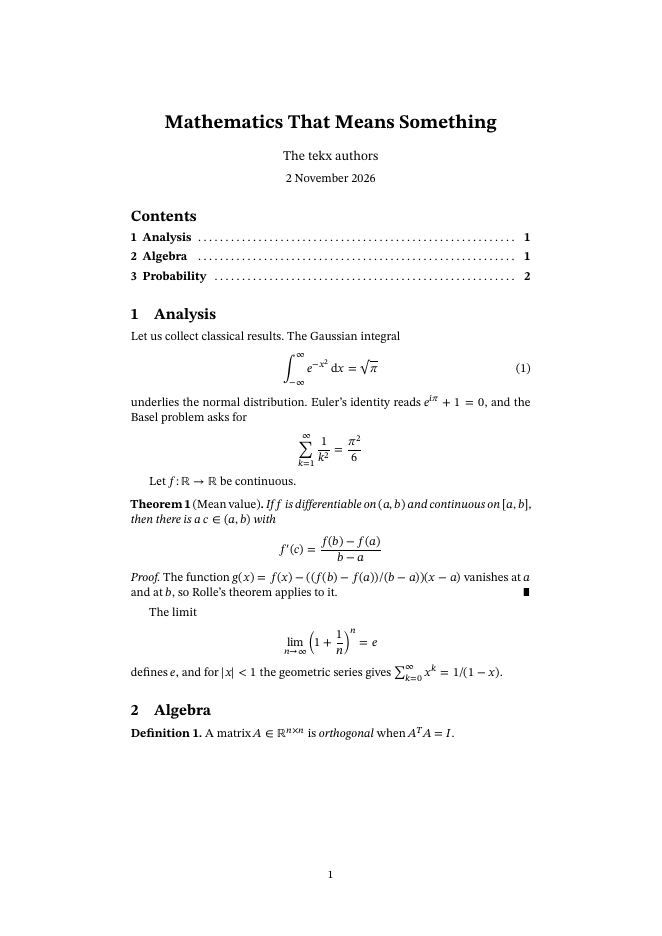

# tekx

**A math-first typesetter.** You write mathematics the way you say it:

```
theorem "Gauss" #gauss
  For every natural number $n$,

      sum k for k from 1 to n = n(n + 1)/2
```

`tekx paper.tekx` writes `paper.pdf`. It does so silently, in one self-contained
binary of C17, libc and libm. There are no packages to install, no auxiliary
files, and no second run.



## Three things no other system does together

**1. Math that means something.** One formula source gives you four outputs:

| from `limit of sin x / x as x approaches 0 = 1` | |
|---|---|
| typeset | the formula, laid out with the font's OpenType MATH table |
| MathML | `<munder><mo>lim</mo><mrow><mi>𝑥</mi><mo>→</mo><mn>0</mn></mrow></munder>…`, attached to the PDF |
| speech | *the limit as x approaches 0 of the fraction with numerator sine x and denominator x end fraction equals 1* |
| copy text | `lim_(x→0) (sin x)/x = 1` |

The copy text is not a lossy rendering. **tekx reads it back as the same formula.**
The test suite checks this property on every formula in
[`test/formulas.txt`](test/formulas.txt).

**2. One compiler, start to finish.** The macro language, the parser, math
layout, Knuth–Plass line breaking with Liang hyphenation, pagination,
cross-references, font subsetting (CFF and TrueType), compression and the PDF
writer are all in this repository and all in the binary. The STIX Two and
Libertinus fonts are compiled in.

**3. Accessible and copy-perfect by construction.** Every PDF that tekx writes is
tagged PDF 2.0 and validates as **PDF/UA-2** and **WTPDF** (accessibility and
reuse) with veraPDF. Each formula is tagged with MathML structure, has spoken
alternative text, and carries its MathML and tekx source as associated files.
Copy and paste gives you real text:
- spaces are real space characters;
- hyphenated words come back whole;
- formulas come back as linear text you can paste into a tekx file;
- page numbers and decoration are marked as artifacts and stay out of the way.

## The language

The design takes after Ruby: it reads like prose, and it has a little structure
where the meaning needs it. Indentation, or `do … end`, makes blocks. Any line
indented further than the text around it is display mathematics.

```
title "On Primes"
author "Ada Lovelace"
date today

define function zeta
define block note(title = "Note")
  quote
    **{title}.** {body}

abstract
  We revisit Euler's product.

section Euler's product #euler

For $s > 1$ the zeta function factors over the primes:

    zeta(s) = sum 1/n^s for n from 1 to infinity
            = prod_(p prime) 1/(1 - p^(-s))       #euler-product

note "History"
  Euler found @euler-product in 1737.

The absolute value is a function defined by cases:

    abs(x) = cases
      x    if x >= 0
      -x   otherwise
```

- **Mathematics:**
  - **Operators and limits:** `sum … for k from 1 to n`, `integral of f(x) dx from a to b`, `limit of … as x approaches 0`.
  - **Roots and functions:** `sqrt`, `square root of`, `abs`, `norm`, `floor`, `binom(n, k)`, `n choose k`.
  - **Arrays:** matrices as `[1, 2; 3, 4]` or as indented rows, and `cases`.
  - **Styles and accents:** `hat`, `vec`, `bb`, `cal`, `frak`, `bold`.
  - **Letters and symbols:** Greek by name, `RR` `NN` `ZZ`, every Unicode symbol, `x1` for x₁.
  - **Spacing groups:** `1/2 x` means ½·x and `h/2pi` means h/(2π).
- **Structure:** `section` or `#`, theorem-like blocks with numbering, `proof` with ∎, lists, tables, quotes, code, `abstract`, `contents`, `references`.
- **Figures:** PNG or JPEG with a numbered caption. Alt text is required, so a figure cannot be inaccessible.
- **Cross-references:** mark a target with `#label` and refer to it with `@label`. The reference reads "Section 2", "Theorem 3", "(4)" or "[1]" and links to its target.
- **Macros:**
  - text macros, `{name}`;
  - block macros, which take parameters, defaults and a `{body}`;
  - math notation, `define norm2(v) as ||v||_2 read as "the two-norm of {v}"`;
  - new theorem-like environments, `define axiom like theorem`.

The full reference is [doc/language.md](doc/language.md).

## One source, two accessible outputs

`tekx paper.tekx` writes the PDF; `tekx -o paper.html paper.tekx` writes a web
page from the same source. The page uses semantic HTML, native MathML for every
formula (which browsers render and screen readers can navigate), and the same
numbers, cross-references and footnotes as the PDF. The HTML back end is one
more filter reading the same tree as the typesetter:
`tekx pp | tekx parse | tekx eqn | tekx html`.

## The hidden machinery

Inside, tekx is a Unix pipeline of five small filters connected by text
streams. Each stage can be run alone and its output read by eye:

```
tekx pp    <paper.tekx |   # macros, comments, do/end            (cf. cpp, m4)
tekx parse |               # document structure as an indented tree
tekx eqn   |               # mathematics: layout, MathML, speech  (cf. eqn)
tekx set   |               # lines and pages: a page description  (cf. troff)
tekx pdf   >paper.pdf      # device back end: tagged PDF/UA-2     (cf. ditroff)
```

`tekx -E`, `-P`, `-M` and `-S` stop after each stage, the way `cc -E` and `cc -S`
do. Diagnostics follow the compiler convention, `file:line:col: error: …`, and
come with suggestions (*did you mean @start?*). The formats and the design are
described in [doc/machinery.md](doc/machinery.md).

## Building

```bash
make
```

```bash
./tekx examples/tour.tekx
```

```bash
make test
```

```bash
make install PREFIX=$HOME/.local
```

You need a C17 compiler and `make`; nothing else. `make test` builds an
AddressSanitizer/UBSan binary and runs the suite on it:
- unit tests;
- the copy-text round trip;
- golden trees and MathML;
- expected diagnostics;
- reproducible, identical debug and optimized builds;
- the shell pipeline against the driver.

Set `VERAPDF=/path/to/verapdf` to add PDF/UA-2, WTPDF accessibility and WTPDF
reuse validation of every example.

Output is reproducible: set `SOURCE_DATE_EPOCH` and the same input gives the same
bytes.

## Status

tekx 0.1 typesets articles: titles, abstracts, sections, theorems and proofs,
lists, tables, figures, code, displayed and inline mathematics,
cross-references, footnotes, contents and references. It does not yet do:
- multiple columns;
- bibliography databases;
- hyphenation for languages other than English.

The built-in fonts are STIX Two (text and math) and Libertinus Mono. Replace any
of them with `font text|italic|bold|bolditalic|math|mono FILE`.

## Repository

| path | contents |
|---|---|
| `src/` | the compiler: one file per stage, plus the font engine (`font.c`, `cff.c`, `ttf.c`, `otl.c`, `mathtab.c`), images (`img.c`), `deflate.c`, `md5.c` and `hyph.c` |
| `doc/` | language reference, machinery, manual page `tekx.1` |
| `examples/` | example documents with their PDFs |
| `test/` | the test suite |
| `assets/` | fonts (OFL) and hyphenation patterns, compiled into the binary |
| `research/` | the audit of the LaTeX tagged-PDF stack that motivated tekx |

## License

tekx is licensed under the Apache License 2.0; see [LICENSE](LICENSE). The bundled
fonts are under the SIL Open Font License, and the hyphenation patterns are under
their own permissive license; see [assets/fonts/NOTICE](assets/fonts/NOTICE) and
[assets/hyphenation/NOTICE](assets/hyphenation/NOTICE).
