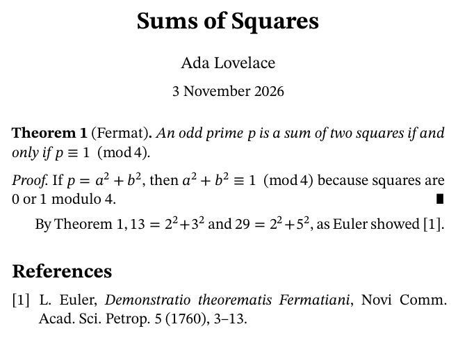

# tekx

tekx typesets mathematics. It reads a plain-text document and writes a tagged
PDF 2.0, an HTML page with MathML, or LaTeX. It is one binary written in C17,
with no dependencies beyond libc and libm.

```
theorem "Fermat" #fermat
  An odd prime $p$ is a sum of two squares if and only if $p equiv 1 (mod 4)$.

proof
  If $p = a^2 + b^2$, then $a^2 + b^2 equiv 1 (mod 4)$ because squares are $0$ or $1$ modulo $4$.

By Theorem @fermat, $13 = 2^2 + 3^2$ and $29 = 2^2 + 5^2$, as Euler showed [@euler].
```



## Build and run

```bash
make
```

```bash
./tekx examples/tour.tekx
```

```bash
make test
```

```bash
make install PREFIX=$HOME/.local
```

`make` needs a C17 compiler. `tekx paper.tekx` writes `paper.pdf`. It writes
nothing else and needs no second run.

## What it does

| | |
|---|---|
| Mathematics | Formulas are written as they are read aloud (`sum k for k from 1 to n`) or in LaTeX notation. Layout follows TeX's rules with the font's OpenType MATH table. 91 of 104 test formulas place every glyph within 0.02 pt of LuaTeX's position. |
| Text | Knuth-Plass line breaking with TeX's passes, hyphenation, character protrusion, and automatic breaking of displays that are too wide. |
| Papers | Theorems, proofs, cross-references, footnotes, figures, tables, contents, BibTeX bibliographies in AMS style, journal front matter. |
| Output | PDF 2.0 that validates as PDF/UA-2, WTPDF and PDF/A-4. Every formula carries MathML and spoken text. Copied text pastes back as the same formula. |
| LaTeX | `tekx import paper.tex` converts a LaTeX paper. `tekx -o paper.tex paper.tekx` writes amsart LaTeX. |
| Packages | `use name 1.2` takes in shared notation and environments, pinned by content hash in `tekx.lock`. |

## Commands

| command | does |
|---|---|
| `tekx paper.tekx` | write `paper.pdf` |
| `tekx -o paper.html paper.tekx` | write a web page with MathML |
| `tekx -o paper.tex paper.tekx` | write amsart LaTeX |
| `tekx -w paper.tekx` | rebuild on every save |
| `tekx new paper` | start a paper from a template, with a `.bib` file |
| `tekx explain 'sin x/y + 1/2 x'` | show how a formula was read |
| `tekx import paper.tex` | convert LaTeX to tekx |
| `tekx pkg add NAME` | add a package |

`tekx explain` prints the grouping tekx chose, what a screen reader says, and
the copy text:

```
$ tekx explain 'sin x/y + 1/2 x'
formula    sin x/y + 1/2 x
reads as   sin(x/y) + (1/2)·x
says       sine the fraction x over y end fraction plus one half x
copies as  sin x/y + 1/2 x
```

## Documentation

| page | covers |
|---|---|
| [doc/language.md](doc/language.md) | the language: documents, blocks, mathematics, references, citations, macros |
| [doc/latex.md](doc/latex.md) | LaTeX notation in formulas, `tekx import`, LaTeX export |
| [doc/packages.md](doc/packages.md) | packages, registries, the lock file, filters |
| [doc/quality.md](doc/quality.md) | how the output compares with LaTeX, measured; what is validated; limits |
| [doc/machinery.md](doc/machinery.md) | the pipeline of filters and the text formats between them |
| [doc/compatibility.md](doc/compatibility.md) | what stays stable from one version to the next |
| [doc/tekx.1](doc/tekx.1) | the manual page |
| [CHANGELOG.md](CHANGELOG.md) | changes by version |

## Repository

| path | contents |
|---|---|
| `src/` | the compiler: one file per stage, the font engine, images, compression |
| `doc/` | documentation; `doc/img/make.sh` renders its pictures |
| `examples/` | example documents and their output |
| `test/` | the test suite, run by `make test` |
| `editors/` | syntax highlighting for Vim and VS Code |
| `assets/` | fonts and hyphenation patterns, compiled into the binary |
| `research/` | the audit of the LaTeX tagged-PDF stack that preceded tekx |

## License

Apache License 2.0; see [LICENSE](LICENSE). The bundled fonts are under the SIL
Open Font License and the hyphenation patterns under their own permissive
license; see [assets/fonts/NOTICE](assets/fonts/NOTICE) and
[assets/hyphenation/NOTICE](assets/hyphenation/NOTICE).
