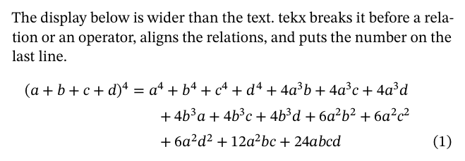
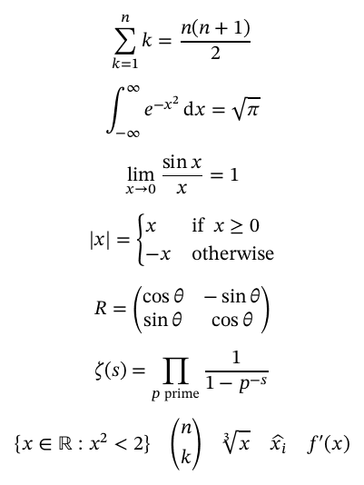

# The tekx language

A tekx file is UTF-8 text. A keyword at the start of a line starts a block.
Indentation, or `do ... end`, gives a block its body. A line indented further
than the text around it is a displayed formula.

| section | |
|---|---|
| [Settings](#settings) | title, authors, numbering, paper, fonts |
| [Blocks](#blocks) | paragraphs, headings, theorems, lists, tables, displays, figures |
| [Inline text](#inline-text) | emphasis, links, footnotes, quotes, dashes |
| [Mathematics](#mathematics) | atoms, operators, scripts, functions, big operators, fences, accents |
| [References](#references) | `#label` and `@label` |
| [Citations](#citations) | BibTeX and the reference list |
| [Definitions](#definitions) | macros, notation, environments, packages |
| [Errors](#errors) | what a diagnostic looks like |

LaTeX notation inside formulas is described in [latex.md](latex.md).

## Settings

```
tekx 1.0
title "Gaps Between Sums of Two Squares"
author "Ada Lovelace", affiliation: "University of London", email: "ada@example.org"
author "Charles Babbage", affiliation: "Cambridge", orcid: "0000-0002-1825-0097"
date today
msc "11N36 (primary); 11E25 (secondary)"
keywords "sums of two squares, short intervals"
numbering by section
bibliography "refs.bib"
```

| setting | effect |
|---|---|
| `tekx 1.0` | the version the document is written for; see [compatibility.md](compatibility.md) |
| `title TEXT` | the title; also the PDF title |
| `subtitle TEXT` | under the title; also the PDF subject |
| `author TEXT` | authors separated by ` and ` |
| `author "Name", affiliation: "...", email: "..."` | one author with details; also `orcid:` and `url:`; `affiliation:` may repeat |
| `date TEXT` | a date as written, or `today` (honours `SOURCE_DATE_EPOCH`) |
| `language TAG` | a BCP 47 tag; default `en` |
| `keywords TEXT` | printed after the abstract; also the PDF keywords |
| `msc TEXT` | the Mathematics Subject Classification, printed after the abstract |
| `numbering by section` | Theorem 2.3 and (2.3); default `numbering continuous` |
| `bibliography "refs.bib"` | BibTeX databases, separated by commas |
| `running "Short Title"` | running heads: the short title on odd pages, the authors on even pages |
| `linenumbers on` | line numbers every fifth line, for referees |
| `citations alphabetic` | labels such as [Hoo71]; `citations ordered` numbers by first citation; default `numeric` |
| `notation tex` | read every formula as LaTeX; see [latex.md](latex.md) |
| `paper a4` | `a4` (default), `a5` or `letter` |
| `size 11` | body size in points, 6 to 24 |
| `font ROLE FILE` | replace a font; ROLE is `text`, `italic`, `bold`, `bolditalic`, `math` or `mono` |

Quotes around a value are optional and protect commas. Each setting has one
spelling. A line that looks like a misspelled setting (`affilation "London"`)
is an error with a suggestion. A `math` font needs an OpenType MATH table.

## Blocks

Blocks are separated by blank lines. These two are the same:

```
theorem "Pythagoras"
  The body, indented.

theorem "Pythagoras" do
The body, delimited.
end
```

### Paragraphs

Consecutive lines form a paragraph. The first line is indented, except after
a heading or a display. Text after a display that starts with a lowercase
letter continues the paragraph.

### Headings

```
section Introduction #intro
subsection Notation
subsubsection Conventions
section* Acknowledgements        // unnumbered
# Introduction                   // the same as section
```

Sections are numbered 1, 1.1, 1.1.1. A line holding only `appendix` makes the
sections after it Appendix A, B, with A.1 and, by section, Lemma A.1 and (A.1).

### Theorems and proofs

```
theorem "Fermat" #fermat
  There are no positive integers with $a^n + b^n = c^n$ for $n > 2$.

proof
  The margin is too small.
```

| kinds | body |
|---|---|
| `theorem` `lemma` `proposition` `corollary` `conjecture` `claim` `axiom` `hypothesis` `fact` | italic |
| `definition` `example` `exercise` `problem` `solution` `notation` `assumption` | upright |
| `remark` `note` `observation` | italic head, upright body |

They share one counter and take an optional title and `#label`. A star
(`theorem*`) leaves one unnumbered. `proof` ends with ∎ at the right margin;
`proof "Proof of @fermat"` replaces its head.

### Lists, tables, quotations, code

```
- an item
- another
  1. nested and numbered
  2. like this

| Symbol | Meaning         |
|:------:|-----------------|
| $NN$   | natural numbers |

> A quotation.
```

Bullets are `-`, `+` or `*`; numbers are `1.` or `1)`. Table rows above the
separator are headers; colons align columns. Code goes between ```` ``` ````
fences.

| block | meaning |
|---|---|
| `abstract` | the abstract |
| `quote` | a quotation, the same as lines starting with `> ` |
| `let f: RR -> RR be continuous` | "Let f : ℝ → ℝ be continuous."; declares `f` a function |
| `contents` | a table of contents with page numbers and links |
| `references` | a reference list given by hand: `key: text` |
| `newpage` | a page break |

Comments run from `//` to the end of the line.

### Displays

```
The Gaussian integral

    integral of e^(-x^2) dx from -infinity to infinity = sqrt pi   #gauss

underlies the normal distribution.
```

- `#label` at the end of a line numbers it. Only labelled lines are numbered.
- Consecutive display lines form one display, aligned at their first relation
  or at `&`. A line that starts with a relation continues the one above.
- A display wider than the text is broken before a relation or an operator.
  The equation number goes on the last line.
- `cases` and the matrix keywords take the lines indented below them as rows.
- `$$ formula $$` is also a display.

```
    abs(x) = cases
      x    if x >= 0
      -x   otherwise

    R = matrix
      cos theta   -sin theta
      sin theta   cos theta
```



A fraction written `a/b` is stacked in a display and set on the line in text
and in scripts: `x^(1/4)`. `frac(a, b)` and `a over b` always stack.

### Figures

```
figure "plot.png" width 60% #plot
  alt "The parabola y = x squared, opening upwards through the origin."
  The graph of $y = x^2$.
```

PNG or JPEG, centred, with a numbered caption. `width` is a percentage of the
text width or a length in `cm`, `mm`, `in` or `pt`. `alt` is required: it is
what a reader who cannot see the image is told.

## Inline text

| write | get |
|---|---|
| `*emphasis*` | italic |
| `**strong**` | bold |
| `` `code` `` | monospaced |
| `$x^2$` | a formula |
| `[text](https://...)`, `<https://...>` | a link |
| `@label` | a cross-reference |
| `^[text]` | a footnote |
| `{name}` | a text macro |
| `--` `---` `...` | en dash, em dash, ellipsis |
| `"quotes"` | “quotes” |
| `~` | a non-breaking space |
| `\*` | a literal character |

A lone `$`, as in `$5 and $10`, stays a dollar sign.

## Mathematics

A formula is written the way it is read aloud.

```
    sum k for k from 1 to n = n(n + 1)/2

    integral of e^(-x^2) dx from -infinity to infinity = sqrt pi

    limit of sin x / x as x approaches 0 = 1

    zeta(s) = prod_(p prime) 1/(1 - p^(-s))

    {x in RR : x^2 < 2}  quad  binom(n, k)  quad  root 3 of x  quad  hat x_i  quad  f'(x)
```



### Atoms

| write | get |
|---|---|
| `x` | an italic variable |
| `alpha` ... `omega`, `Gamma` ... `Omega`, `varepsilon`, `varphi` | Greek letters |
| `x1`, `alpha2` | x₁, α₂ |
| `RR NN ZZ QQ CC` | ℝ ℕ ℤ ℚ ℂ |
| `infinity` `partial` `nabla` `emptyset` `aleph` `hbar` `ell` | ∞ ∂ ∇ ∅ ℵ ℏ ℓ |
| `"speed"` | text |
| `if` `otherwise` `and` `or` `when` `where` `for all` | text, without quotes |
| `velocity` | a word of four or more letters is one upright name |
| `abc` | a shorter unknown word is a product, a·b·c |
| `∑ ≤ ∀ x² a₁` | Unicode, typed directly |

### Operators, loosest first

| binding | operators |
|---|---|
| 1 | `&` |
| 2, 3 | `;` `,` |
| 5 | `if` `when` `where` `for` `otherwise` |
| 8 | `:` |
| 10, 12 | `<=>` `iff`, `=>` `implies` |
| 14, 16 | `or`, `and` |
| 20 | `=` `!=` `<` `>` `<=` `>=` `~` `approx` `equiv` `in` `notin` `subset` `subseteq` `->` `to` `mapsto` `:=` `divides` |
| 30 | `over` |
| 40 | `+` `-` `+-` `union` `setminus` `oplus` |
| 42 | `/` with blanks around it |
| 45 | juxtaposition with a blank: `2 x` |
| 50 | `*` `times` `cdot` `div` `intersect` `circ` `otimes` `mod`, `/` without blanks |
| 55 | unary `-` |
| 60 | juxtaposition without a blank: `2x`, `n(n + 1)` |
| 70 | `^` `_` `!` `'` `squared` `inverse` `transpose` |

Blanks group: `1/2 x` is ½·x, `1/2x` is 1/(2x), `h/2pi` is h/(2π). `/` drops
parentheses that only group: `(a + b)/(c - d)`. `a equiv b (mod n)` sets the
modulus as amsmath's `\pmod` does.

### Scripts and functions

`x^2`, `x_i`, `x_i^2`, `x^(n+1)`, `x_max` (a word of three or more letters is
upright), `f'`, `f''`, `e^-x`, `A^T`, `x squared`, `f inverse`.

`sin`, `cos`, `log`, `exp`, `det`, `gcd` and names declared with
`define operator` are upright and take an argument without parentheses:
`sin 2 pi x`. The argument runs until `+`, a relation or another function name.
`f`, `g`, `h`, names declared with `define function`, and names introduced by
`f(x) = ...` or `let` apply to a parenthesized argument: `f(x)`, `f^(-1)(y)`.

### Big operators

```
sum k^2 for k from 1 to n           sum_(k=1)^n k^2
sum over i in I of x_i              prod_(p prime) 1/(1 - p^(-s))
integral of f(x) dx from 0 to 1     integral_0^1 f(x) dx
limit of f(x) as x approaches 0     lim_(x -> 0) f(x)
max_(i) a_i   sup   inf   limsup    union_(i=1)^n A_i
```

A big operator's body stops at `+`, `-` and relations. Integrals end at their
differential, set with an upright d. In a display, limits of sums, products,
unions and `lim` go under and over; those of integrals go beside.

### Roots, fences, arrays

| write | get |
|---|---|
| `sqrt x`, `square root of x` | √x |
| `root 3 of x`, `cube root of x` | ∛x |
| `abs(x)`, `|x|` | \|x\| |
| `norm(v)`, `||v||` | ‖v‖ |
| `floor(x)`, `ceil(x)` | ⌊x⌋, ⌈x⌉ |
| `binom(n, k)`, `n choose k` | a binomial coefficient |
| `{x in RR : x > 0}` | a set |
| `[0, 1)` | an interval |
| `[1, 2; 3, 4]`, `matrix(1, 2; 3, 4)` | a matrix |
| `cases(x if x >= 0; -x otherwise)` | cases |

Brackets grow when their content is taller than they are.

### Accents and styles

`hat x`, `bar x`, `vec v`, `tilde x`, `dot x`, `ddot x`, `overline(z + w)`;
`bb R`, `cal A`, `frak g`, `bold v`, `sans x`, `mono x`, `upright d`,
`text "words"`. `quad` and `qquad` are spaces of 1 and 2 em.

`for all epsilon > 0, there exists delta > 0` sets ∀ε > 0, ∃δ > 0.

### What a formula produces

| output | example for `sum k^2 for k from 1 to n` |
|---|---|
| layout | TeX's rules with the font's OpenType MATH constants |
| MathML | PDF structure elements and an associated file |
| speech | "the sum from k equals 1 to n of k squared" |
| copy text | `∑_(k=1)^n k²`, which reads back as the same formula |

`tekx explain` shows all of these for a formula given as an argument or on
standard input.

## References

Mark a target with `#label` after a heading, a theorem line, a display line
or a figure. Refer to it with `@label`.

| target | reads |
|---|---|
| section | Section 2.1 |
| theorem | Theorem 3 |
| display line | (5) |
| figure | Figure 2 |
| appendix | Appendix A |

References may point forward and are links. `Theorem @main` reads "Theorem 3",
`(@gauss)` reads "(5)", and `Lemmas @a and @b` reads "Lemmas 2 and 4".

## Citations

```
bibliography "refs.bib"

Landau [@landau] improved [@hooley, Thm. 2; @bambah].
```

| write | get |
|---|---|
| `[@key]` | [3] |
| `[@a; @b; @c]` | [1–3] |
| `[@key, Thm. 2]` | [3, Thm. 2] |
| `@key` | [3], when no `#key` target exists |

The `.bib` file is read as BibTeX reads it: `@string`, `#`, accents, names in
every form, crossref. Only cited entries are printed, sorted as amsplain sorts
them, in AMS style. DOIs and arXiv identifiers become links. Problems in a
`.bib` file are warnings; citing an entry that could not be read is an error.

## Definitions

Definitions may be used before the line that makes them.

```
define brand as "tekx"
define cite(who, year = "2026") as "{who} ({year})"

define block aside(title = "Aside")
  quote
    **{title}.** {body}

define function phi, psi
define operator Var, Tr
define norm2(v) as ||v||_2 read as "the two-norm of {v}"
define axiom2 like theorem titled "Postulate"

use house-notation 1.2
```

| definition | use |
|---|---|
| text macro | `{brand}`, `{cite(Knuth)}`, `{cite year: 1984, who: Knuth}` |
| block macro | `aside "Careful"` with an indented body that replaces `{body}` |
| function, operator | `phi(x)` applies; `Tr A` is upright and prefix |
| notation | `norm2(v)` expands in the formula; `read as` replaces its speech |
| environment | `axiom2` is numbered and styled like a theorem |
| package | see [packages.md](packages.md) |

## Errors

```
paper.tekx:5:16: error: unknown macro {golden} (define it with: define golden as "...")
paper.tekx:7:1: error: unknown block 'theorm'; did you mean 'theorem'?
paper.tekx:12:5: error: unknown label @strat; did you mean @start?
```

When there is an error, nothing is written.
