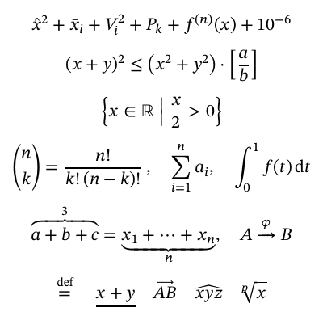

# LaTeX

tekx reads LaTeX notation inside formulas, converts LaTeX papers, and writes
LaTeX for journals.

| | |
|---|---|
| [Notation](#notation) | LaTeX commands inside a formula |
| [Import](#import) | `tekx import paper.tex` |
| [Export](#export) | `tekx -o paper.tex paper.tekx` |

## Notation

A formula that contains a TeX command is read as LaTeX reads it. `notation tex`
at the top of a document reads every formula that way, including `$a_{ij}$` and
`$ABCD$`.

```
notation tex

    \hat{x}^2 + \bar{x}_i + V_i^2 + P_k + f^{(n)}(x) + 10^{-6}

    (x+y)^2 \le \bigl( x^2 + y^2 \bigr) \cdot \Bigl[ \frac{a}{b} \Bigr]

    \left\{ x \in \mathbb{R} \;\middle|\; \frac{x}{2} > 0 \right\}

    \binom{n}{k} = \frac{n!}{k!\,(n-k)!}, \quad \sum\limits_{i=1}^{n} a_i, \quad \int_0^1 f(t)\,dt

    \overbrace{a + b + c}^{3} = \underbrace{x_1 + \dots + x_n}_{n}, \quad A \xrightarrow{\varphi} B

    \overset{\text{def}}{=} \quad \underline{x + y} \quad \overrightarrow{AB} \quad \widehat{xyz} \quad \sqrt[p]{x}
```



The layout follows TeX and amsmath. A bare bracket keeps its size, as in TeX;
`\left`, `\right`, `\middle` and `\big` to `\Bigg` size it. The MathML, speech
and copy text are the same as for the formula written in tekx notation. The copy
text is tekx notation.

| kind | commands |
|---|---|
| fractions, roots | `\frac` `\dfrac` `\tfrac` `\cfrac` `\binom` `\dbinom` `\tbinom` `\sqrt` `\sqrt[n]` |
| text, names | `\text` `\mbox` `\mathrm` `\operatorname` `\mathop` `\pmod` |
| letters | `\mathbb` `\mathcal` `\mathscr` `\mathfrak` `\mathbf` `\boldsymbol` `\bm` `\mathsf` `\mathtt` `\mathit` |
| accents | `\hat` `\bar` `\tilde` `\vec` `\dot` `\ddot` `\check` `\breve` `\widehat` `\widetilde` `\overline` `\overrightarrow` `\overleftarrow` |
| stacks | `\underline` `\overbrace` `\underbrace` `\overset` `\underset` `\stackrel` `\xrightarrow` `\xleftarrow` |
| delimiters | `\left` `\right` `\middle` `\big` `\Big` `\bigg` `\Bigg` and their `l`, `r`, `m` forms |
| styles, limits | `\displaystyle` `\textstyle` `\scriptstyle` `\scriptscriptstyle` `\limits` `\nolimits` |
| classes | `\mathrel` `\mathbin` `\mathord` `\mathopen` `\mathclose` `\mathpunct` |
| spacing | `\,` `\:` `\;` `\!` `\ ` `\quad` `\qquad` |
| environments | `pmatrix` `bmatrix` `Bmatrix` `vmatrix` `Vmatrix` `matrix` `cases` `aligned` `gathered` `split` `array` |
| symbols | every Greek letter, operator, relation, arrow and function name under its LaTeX name; `\#` `\$` `\%` `\&` `\_` |

Two choices differ from LaTeX on purpose:
- `\left( x \right)` is spaced as a plain parenthesis. TeX adds thin spaces
  around it.
- `:=` is set as one symbol, ≔.

An unknown command is an error with a suggestion:
`unknown TeX command \fracc; did you mean \frac?`

## Import

```bash
tekx import paper.tex
```

writes `paper.tekx`. It converts:

| LaTeX | tekx |
|---|---|
| amsart and article front matter (`\author`, `\address`, `\email`, `\subjclass`, `\keywords`) | settings |
| sections, `abstract`, `\appendix`, labels | headings with `#label` |
| `\newtheorem` | theorem kinds, or `define NAME like theorem` |
| `equation`, `align`, `gather`, `multline`, `\[ \]`, `$$` | displays; every numbered line keeps its number |
| lists, tables, figures, footnotes, `verbatim`, quotations, links | the same blocks |
| `\ref`, `\eqref`, `\cref`, `\autoref` | `@label` |
| `\cite[note]{a,b}` | `[@a; @b, note]` |
| `\newcommand`, `\def` | expanded where used |
| `\DeclareMathOperator{\Var}{Var}` | `define operator Var` |

Formulas stay in LaTeX notation under `notation tex`. Anything that cannot be
carried over is kept as text and reported as a warning at its line: unknown
commands and environments, `\tag`, and figures, whose alt text is copied from
the caption and should be rewritten.

## Export

```bash
tekx -o paper.tex paper.tekx
```

writes an amsart document that compiles with pdflatex and BibTeX:

- `\newtheorem` declarations with one shared counter;
- `equation` and `align` with labels; references as `Theorem~\ref{x}` and `\eqref{x}`;
- `\cite`, and `\bibliography{...}` when the document has a `bibliography`;
- formulas written from their meaning: `sum k^2 for k from 1 to n` becomes
  `\sum_{k = 1}^{n} k^{2}`.

Nothing beyond amsmath and hyperref is needed. The test suite compiles the
exports when TeX Live is installed.
